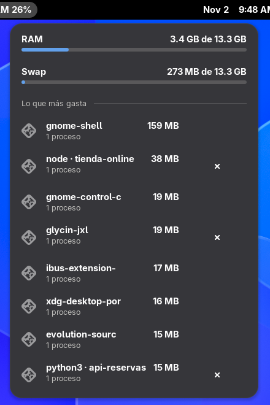

# Memoria

Extensión de GNOME que muestra en la barra de arriba cuánta RAM llevas usada (`RAM 48%`) y, al
hacer clic, la RAM, la swap y los programas que más gastan, con un botón para cerrar alguno.



## Qué hace
- **En la barra**, junto al nombre de la app abierta: el porcentaje de RAM usada. Se pone amarillo
  desde el 80 % y rojo desde el 90 %.
- **Al hacer clic:**
  - RAM y swap usadas, con su barra.
  - Los 8 programas que más gastan, con su icono, memoria (RAM + swap), cuántos procesos tienen y
    cuánto de eso está en swap.
  - Botón **×** para cerrar uno. El primer clic lo convierte en **¿Cerrar?**; el segundo (antes de
    4 segundos) lo cierra. Así no cierras nada por accidente.

## Cómo cuenta la memoria
- Usa **PSS**: la memoria propia de cada proceso más la parte que le toca de la que comparte. Así
  Brave, que tiene decenas de procesos compartiendo memoria, no cuenta dos veces lo mismo.
- **Un programa con ventana** (Brave, Spotify…) junta todos sus procesos hijos del mismo ejecutable.
  Los programas que abres desde la terminal (Claude Code, `node`…) salen aparte, no dentro de la
  terminal.
- **Los intérpretes** (`node`, `python`, `bun`…) y Claude Code se separan por la carpeta donde
  corren: `node · Kaizen-Cup` sale aparte del `node` de otro proyecto, y cerrarlo no toca a los demás.
- **Cerrar una app con ventana** es como elegir "Salir": le da tiempo de guardar. Para lo demás se
  manda la señal de terminar (SIGTERM) y, si a los 5 segundos sigue vivo, se le obliga (SIGKILL).
- Los procesos del escritorio (`gnome-shell`, `Xwayland`, `pipewire`…) salen en la lista pero sin
  botón: cerrarlos rompería la sesión.

La lista la arma `extension/procesos.py` en un proceso aparte (tarda unos 0.3 s), solo mientras el
menú está abierto, para no frenar GNOME. Nada sale de tu computadora.

## Instalar
Requisitos: GNOME Shell 48 a 51 (Wayland o X11) y Python 3.9 o más nuevo.
Probada en CachyOS (Arch) con GNOME 51.

```bash
git clone https://github.com/DimitriMedNov/memoria.git
cd memoria
./install.sh
```

No pide sudo: todo queda en tu usuario (`~/.local/share/gnome-shell/extensions/`).
Después **cierra sesión y vuelve a entrar**. En Wayland, GNOME solo carga extensiones nuevas o
actualizadas al iniciar sesión (bloquear la pantalla no basta).

Para actualizar: `git pull` y otra vez `./install.sh` (y cerrar sesión).
Para quitarla: `./install.sh --quitar`.

## Problemas comunes
- **No la veo después de instalar.** Cierra sesión y vuelve a entrar. Si sigue sin salir, revisa que
  esté activa: `gnome-extensions info memoria@dimitrimednov.github.io` debe decir `State: ACTIVE`.
- **Ver los errores:** `journalctl --user -b -o cat /usr/bin/gnome-shell | grep -i "Memoria"`.
- **Tu GNOME es más nuevo que 51.** Agrega tu versión a `shell-version` en
  `extension/metadata.json`, instala otra vez y prueba. Si algo falla, abre un *issue*.

## Licencia
[MIT](LICENSE). Úsala, cópiala y cámbiala como quieras.
